# Authorization flows

How a caller gets from "a request arrived" to "this is allowed", for each way into skilj. The
diagrams are [Mermaid](https://mermaid.js.org/), which GitHub renders in place. This page is an
overview; the reasoning and the tests behind each rule are in
[`architecture.md`](architecture.md) (the section numbers below point there) and the behaviour
itself is in [`specs/skilj.allium`](../specs/skilj.allium), which wins if they disagree.

**Colors in the flowcharts**

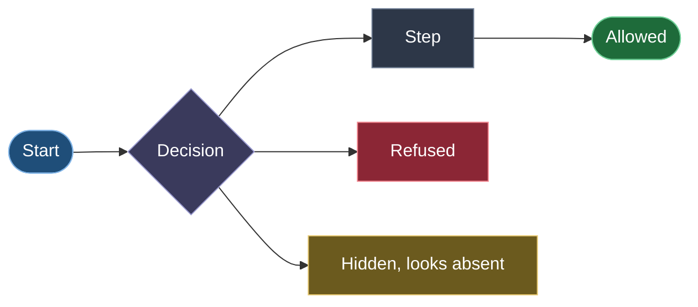

## Contents

1. [The two tracks](#1-the-two-tracks)
2. [Authenticating a GraphQL request](#2-authenticating-a-graphql-request)
3. [A WebSocket's lifetime](#3-a-websockets-lifetime)
4. [Authorizing a GraphQL operation](#4-authorizing-a-graphql-operation)
5. [Submitting a command, end to end](#5-submitting-a-command-end-to-end)
6. [Commands that need approval](#6-commands-that-need-approval)
7. [Fields inside a record you may read](#7-fields-inside-a-record-you-may-read)
8. [Authenticating a REST request](#8-authenticating-a-rest-request)
9. [How access gets there](#9-how-access-gets-there-bootstrap-grants-and-tokens)
10. [Capabilities: who can hand out what](#10-capabilities-who-can-hand-out-what)
11. [The access trail](#11-the-access-trail)

## 1. The two tracks

skilj has two ways in, with two kinds of credential:

| | GraphQL | REST |
|---|---|---|
| For | People and services using the application | Narrow agents and automated callers (§7.1) |
| Credential | A JWT from your identity provider | An admin-issued `<id>.<secret>` token |
| Resolves to | A `Role`, then its `RoleAccessMapping` grants | One `AccessToken`, scoped to one type |
| Scope of access | Whatever the grants allow, per bounded context | Exactly one registered event or command type |
| Who creates the access | A superadmin (Roles) and an admin (grants) | An admin of the bounded context |

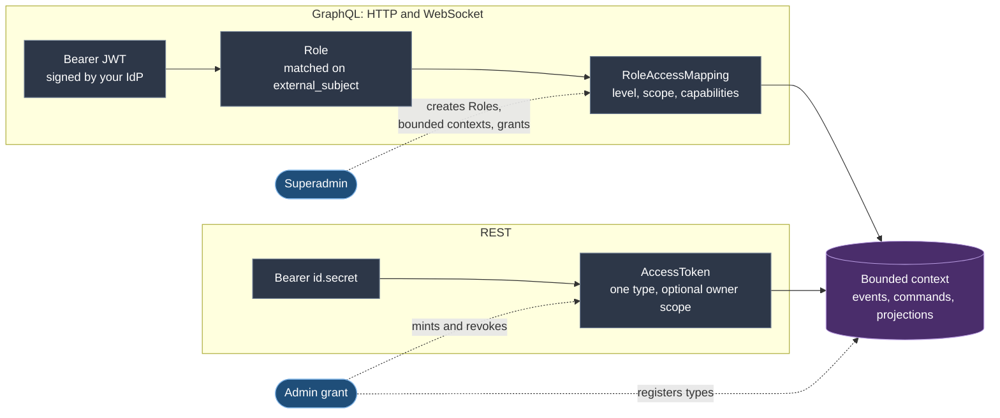

## 2. Authenticating a GraphQL request

Runs on every HTTP request and on every WebSocket `connection_init`. This is the only place
JWTs are validated.

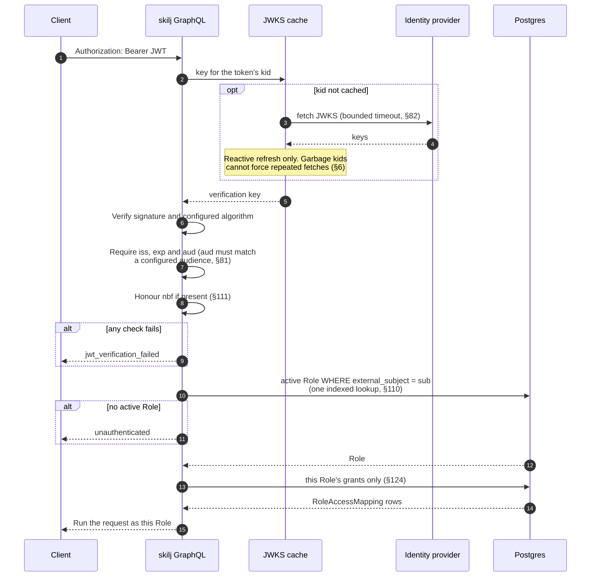

## 3. A WebSocket's lifetime

Subscriptions authenticate once, in `connection_init`, and are then held to that credential
(§135, §136).

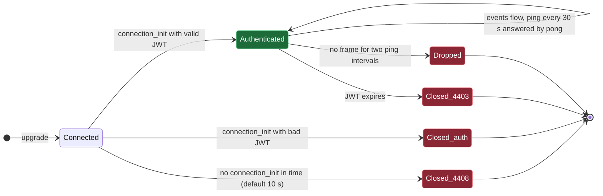

A client such as `skilj-tui` can refresh an expired token with `--token-command` and reconnect,
resuming from its last sequence (§137, §106).

## 4. Authorizing a GraphQL operation

Authentication only says who the caller is. Each operation then asks what that Role's grants on
the named bounded context allow. Checks run top to bottom and a refusal stops the request.

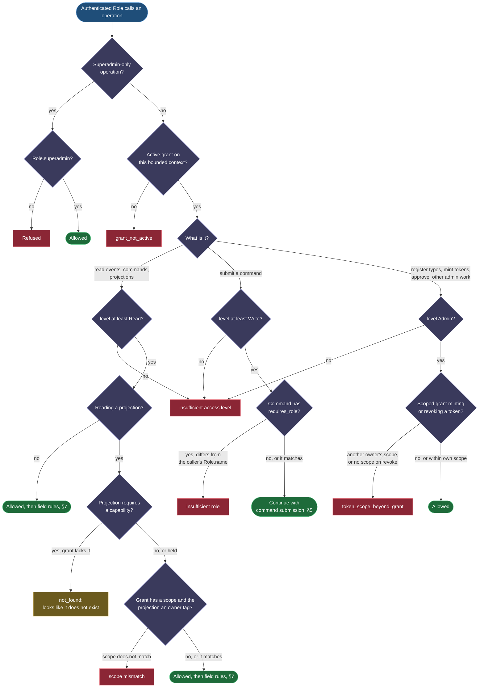

The rules, in short:

- **Level** is `Read`, `Write` or `Admin`, each including the one before.
- **Scope** on a grant confines it to one owner's records wherever a projection declares an owner
  tag, for admin grants too (§23). A scoped admin can only mint or revoke tokens within its own
  scope (§92). Other admin surfaces (type registration, parked deliveries, `forgetSubject`) stay
  bounded-context-wide; a tenant that needs a fully confined admin gets its own bounded context.
- **A refused projection looks like a missing one.** A caller without the capability gets the
  same answer, and the same absent type in its per-caller GraphQL schema, as for a name that does
  not exist (§138, §228).
- **Checks that could leak existence run first.** The superadmin check comes before any
  not-found answer, so a bounded context's existence is not an oracle (§139).

## 5. Submitting a command, end to end

Both surfaces authorize the same way before the command reaches `decide()`. Ordering matters:
an unauthorized caller never reaches the decider (§1.3.1).

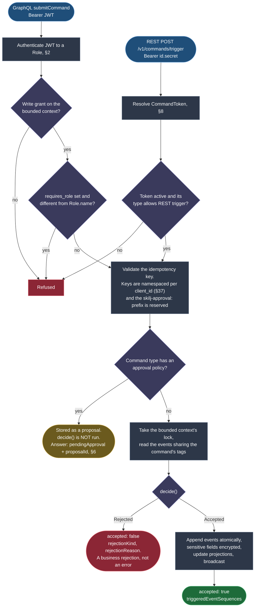

`dryRunCommand` (GraphQL, Admin only) and `POST /v1/commands/dry-run` (REST) run the same
authorization, then report what the decision would be and write nothing (§185).

## 6. Commands that need approval

A command type can declare that a submission is only a proposal, held until an admin approves it
(issue #98, §214). The decision is made against the state at approval time, not at proposal time.

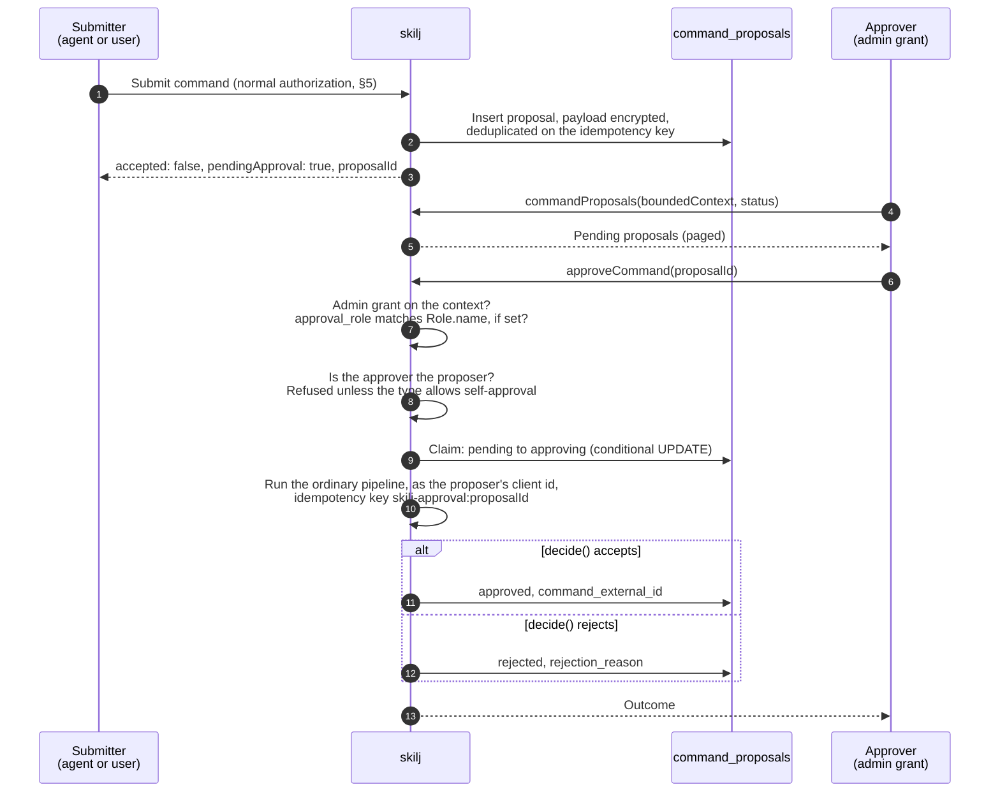

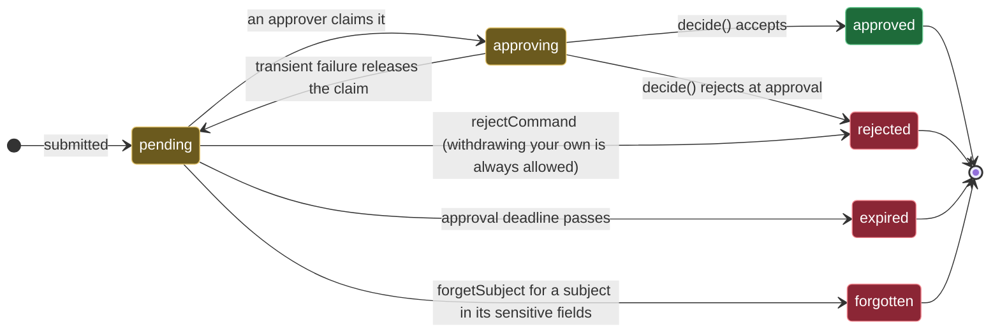

## 7. Fields inside a record you may read

Passing the checks above lets you read a record. Individual fields can still be withheld. This
is decided inside the read, not by redacting afterwards.

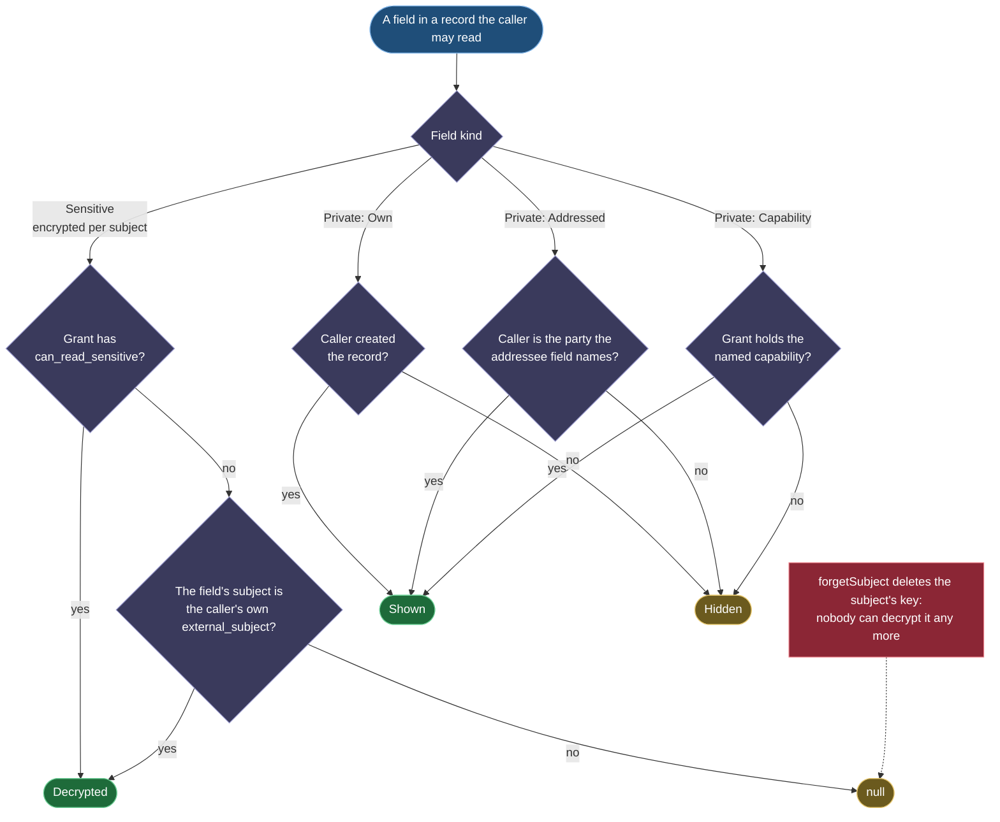

Notes:

- REST reads fail closed on private fields (§31).
- Parked requests and a rejection's `matchingEvents` are masked by the same rules (§118, §119).
- Private fields are redacted in a read, not in stored projection or snapshot state; §177
  documents what a snapshot keeps.

## 8. Authenticating a REST request

There is no JWT here. A route checks that the token is the right kind for it, and the answer to
a wrong credential is deliberately uninformative: a token id alone reveals nothing (§142).

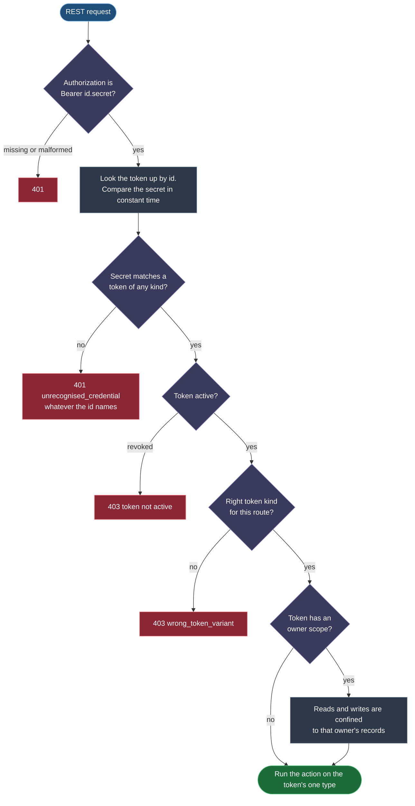

Which token each route takes (§7.2):

| Route | Token kind |
|---|---|
| `POST /v1/events/external`, `/v1/events/external/batch` | `ExternalEventToken` |
| `POST /v1/events/direct` | `DirectCreationToken` |
| `GET /v1/events`, `GET /v1/events/consume`, `POST /v1/events/consume/ack` | `EventReadToken` |
| `POST /v1/commands/trigger`, `/trigger/batch`, `/dry-run` | `CommandToken` |

## 9. How access gets there: bootstrap, grants and tokens

Nothing is allowed by default. A new bounded context is inert until someone is granted access to
it, on purpose.

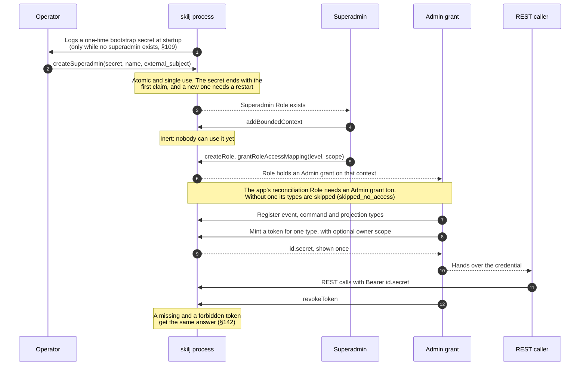

Roles and grants have their own lifecycle. Revoking a Role ends each of its grants, and a
subject can be claimed by only one active Role at a time.

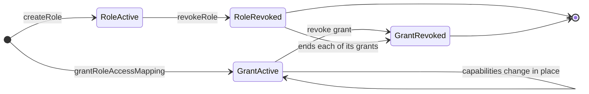

## 10. Capabilities: who can hand out what

A capability is a named privilege on a grant, and it is the only thing that opens a gated
projection or private field. Nothing implies one: not `Admin`, not superadmin, not a Role's name
(§228).

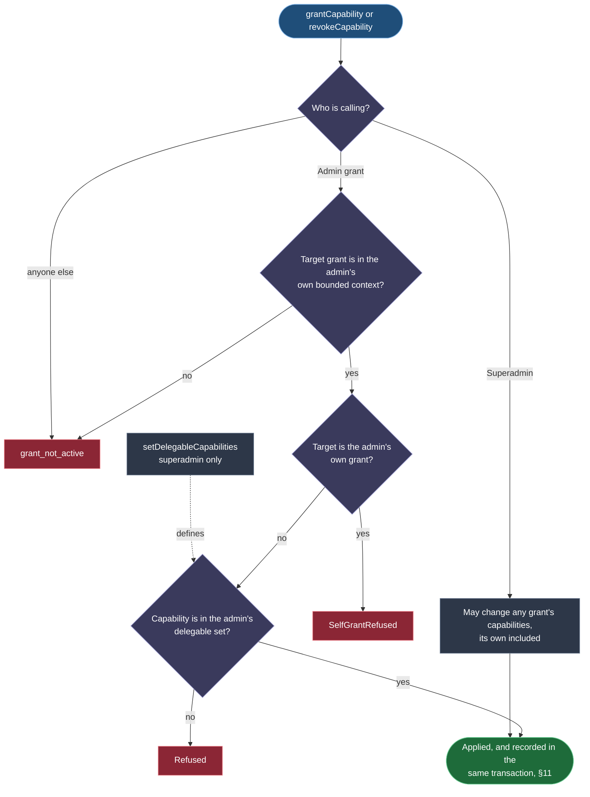

An admin can run a team without being able to read what the team reads: handing out access and
holding it are separate things. Lowering `delegable` does not reach back to what the admin
already granted. A grant holds at most 16 capabilities and delegates at most 16.

Where a capability is required, and what happens without it:

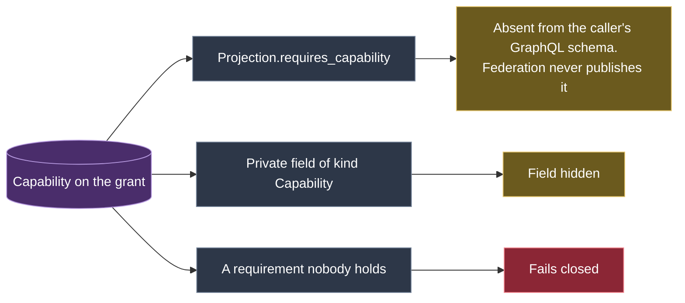

## 11. The access trail

Every change to who holds what is also an event in the `admin` bounded context, written in the
same transaction as the change (§229). If the event cannot be written, the change is not made.

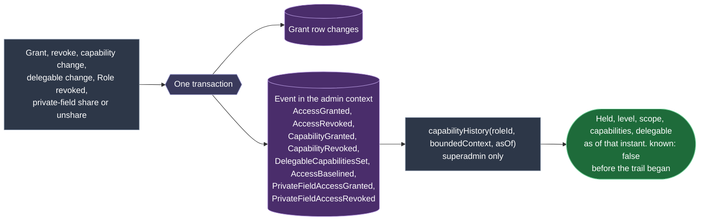

- Payloads hold ids only, never names or subjects, so there is nothing a person could ask to
  have forgotten.
- Refused attempts are not recorded: they change nothing.
- At startup each active grant whose events do not fold to held gets one `AccessBaselined`, so
  history starts from what it held at upgrade. That covers a grant with no events and one that
  only has capability events. A grant revoked before that gets no invented history.
- A revoke that finds nothing left to revoke records nothing. A stored event that does not parse
  fails the read rather than being skipped.
- Sharing the private fields of a record is recorded as `PrivateFieldAccessGranted` and
  `PrivateFieldAccessRevoked`. The grantee is the event's Role and the grantor the actor. These
  name no grant, so they do not count in `capabilityHistory`, and a share made before the trail
  began has no event of its own.
- Deleting a bounded context ends its active grants in the trail (`AccessRevoked` with reason
  `bounded_context_deleted`), so `capabilityHistory` stops reporting them as held. Archiving
  ends nothing and records nothing.
- Revoking a Role ends its grants and records each, but leaves the private-field shares it made or
  holds as they are, with no event (the Role can no longer authenticate).
- Not recorded: denied attempts, reads of gated projections, the other admin operations
  (tokens, type registration, and adding or archiving a bounded context).
